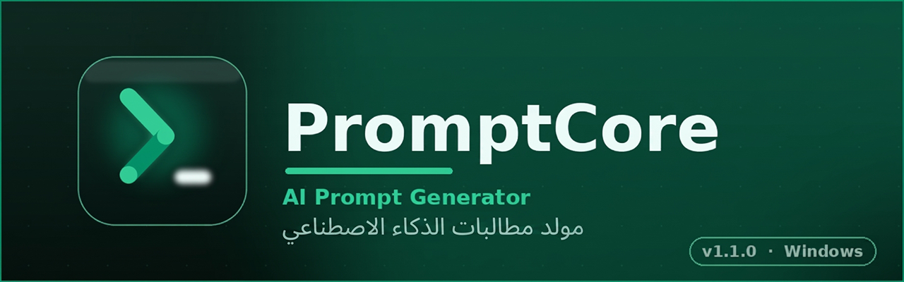
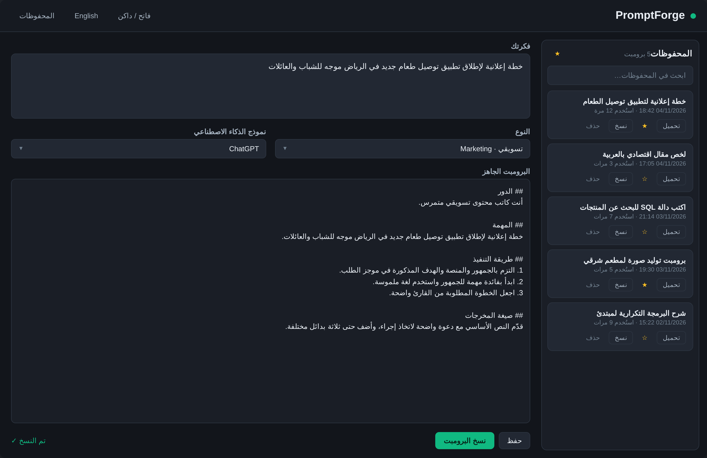
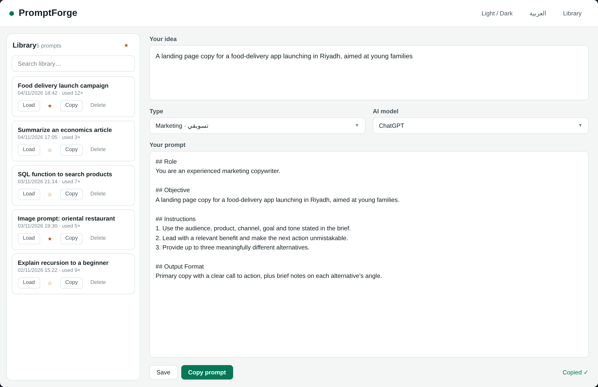
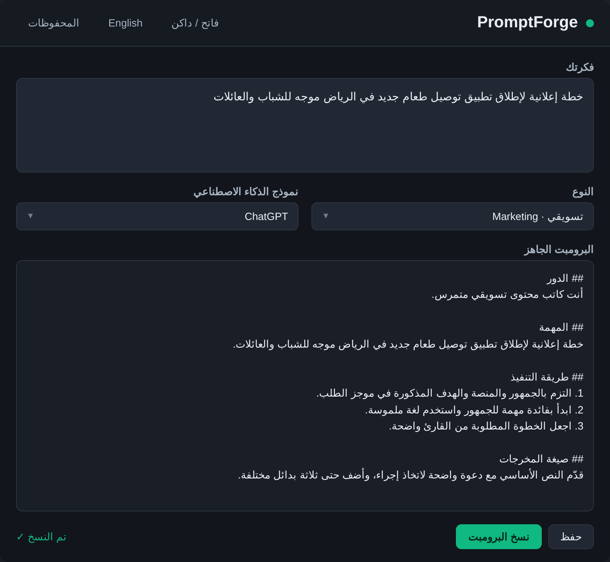

<div align="center">



# PromptCore

**مولّد برومبتات الذكاء الاصطناعي — AI Prompt Generator**

حوّل فكرة قصيرة إلى برومبت احترافي جاهز لأي نموذج ذكاء اصطناعي.


</div>

---

## 📖 نظرة عامة

**PromptCore** تطبيق سطح مكتب لويندوز يساعدك على كتابة برومبتات فعّالة للذكاء الاصطناعي:
اكتب فكرتك بسطر واحد، اختر نوع المهمة والنموذج، وسيبني لك التطبيق برومبتاً منظّماً
بالأقسام القياسية (الدور، السياق، التعليمات، المخرجات المتوقعة…) مع متغيرات قابلة
للتعبئة وملاحظات تحسين فورية.

كل شيء يعمل **دون اتصال بالإنترنت** — برومبتاتك تُحفظ محلياً في قاعدة SQLite خاصة بك.

## ✨ المميزات

- ⚡ **توليد فوري** — من فكرة قصيرة إلى برومبت كامل بضغطة زر
- 🧩 **8 أنواع مهام** — كتابة، برمجة، تحليل، تعليم، تسويق… و9 ملفات تعريف لنماذج الذكاء الاصطناعي
- 🔤 **محرك متغيرات** `{{variable}}` — اكتشاف تلقائي، حقول إلزامية، قوائم منسدلة، وقيم افتراضية
- 🛠️ **مُحسِّن مدمج** — ملاحظات لغوية وبنيوية لرفع جودة البرومبت
- 🗂️ **مكتبة محفوظات** (SQLite) — بحث فوري، مفضلة ★، تحميل، نسخ، وحذف من لوحة جانبية قابلة للطي
- 🌓 **ثيمان** — Emerald Night الداكن و Emerald Day الفاتح، بألوان متوافقة مع معيار WCAG
- 🌐 **عربي / إنجليزي** — تبديل فوري مع دعم RTL كامل، وحفظ تفضيلاتك تلقائياً
- 📤 **استيراد وتصدير JSON** — انقل مكتبتك بين الأجهزة
- 📦 **ملف EXE واحد** — أيقونة مدمجة، لا تثبيت، لا تبعيات

## 📸 لقطات الواجهة

| الثيم الداكن — Emerald Night | الثيم الفاتح — Emerald Day |
|:---:|:---:|
|  |  |

<div align="center">

**اللوحة الجانبية القابلة للطي (المحفوظات + المفضلة)**



</div>

## ⬇️ التحميل والتشغيل

1. حمّل `PromptCore.exe` من صفحة [**Releases**](../../releases)
   - النسخة **المستقلة** (Self-contained): تعمل على أي Windows 10/11 ‏64-bit **بدون أي متطلبات**
   - النسخة **الخفيفة** (~3MB): تتطلب [.NET 10 Desktop Runtime](https://dotnet.microsoft.com/download/dotnet/10.0)
2. شغّل الملف مباشرة — لا تثبيت مطلوب
3. بياناتك تُحفظ في: `%AppData%\PromptCore\promptcore.db`

> 🔄 قادم من الإصدار القديم (PromptForge)؟ قاعدة بياناتك تُنسى تلقائياً عند أول تشغيل.

## 🛠️ البناء من المصدر

```bash
git clone https://github.com/abukasim0/PromptCore.git
cd PromptCore

dotnet test                                # 37 اختباراً
dotnet run --project src/PromptCore.UI     # تشغيل التطبيق
```

تصدير ملف EXE بملف واحد:

```bash
dotnet publish src/PromptCore.UI -c Release -r win-x64 \
  --self-contained true \
  -p:PublishSingleFile=true \
  -p:IncludeNativeLibrariesForSelfExtract=true \
  -p:EnableCompressionInSingleFile=true
```

## 📁 هيكل المشروع

```
PromptCore/
├── PromptCore.slnx
├── src/
│   ├── PromptCore.Core    # منطق الأعمال: التوليد، المتغيرات، المُحسِّن، ملفات النماذج
│   ├── PromptCore.Data    # طبقة SQLite: 5 جداول + فهارس + ترحيلات إصدارية (WAL)
│   └── PromptCore.UI      # واجهة WPF: ثيمات، سلاسل عربي/إنجليزي، MVVM
├── tests/
│   └── PromptCore.UnitTests
└── docs/
    └── db-schema.sql      # مخطط قاعدة البيانات المرجعي
```

## 🧱 التقنيات

| | |
|---|---|
| اللغة والمنصة | C# / .NET 10 — WPF |
| النمط المعماري | MVVM (CommunityToolkit.Mvvm 8.4) |
| التخزين | SQLite عبر Microsoft.Data.Sqlite 10 — وضع WAL مع ترحيلات `user_version` |
| الاختبارات | xUnit — 37 اختباراً للمحرّك والتخزين |
| إمكانية الوصول | ألوان مطابقة لمعيار WCAG AA/AAA |

## 🗺️ خارطة الطريق

- [x] مكتبة محفوظات SQLite مع المفضلة والبحث
- [x] ثيم داكن/فاتح + واجهة عربية/إنجليزية
- [x] أيقونة التطبيق ونافذة «حول»
- [ ] بحث نصي كامل FTS5 في المكتبة
- [ ] عارض كامل لسجل الاستخدام (History)
- [ ] حزمة تثبيت رسومية (Installer)

## 👤 المطور والتواصل

<div align="center">

| | |
|:---:|:---:|
| 👤 **تطوير** | **Abu Kasim** |
| 🐙 **جيت هاب** | [github.com/abukasim0](https://github.com/abukasim0) |
| 📢 **قناة التليجرام** | [t.me/programs_edditing](https://t.me/programs_edditing) |
| 🌐 **المدونة الرسمية** | [filefreesy.blogspot.com](https://filefreesy.blogspot.com) |
| 🔗 **كافة الروابط** | [linktr.ee/abukasim](https://linktr.ee/abukasim) |
| 💬 **للتواصل المباشر** | [@Abu_Kasim](https://t.me/Abu_Kasim) |

⭐ نجمة على المستودع تدعم استمرار التطوير

</div>

## 📄 الترخيص

© 2026 **Abu Kasim** — جميع الحقوق محفوظة. للاستخدام أو إعادة النشر، [تواصل معي مباشرة](https://t.me/Abu_Kasim).

---

## 🇬🇧 English Summary

**PromptCore** is a Windows desktop app (WPF / .NET 10) that turns a one-line idea
into a well-structured, ready-to-use AI prompt. It ships 8 task types, 9 model
profiles, a `{{variable}}` engine with auto-detection, a built-in prompt optimizer,
and a local SQLite library with favorites, search and JSON import/export — fully
offline, Arabic/English UI with dark & light themes.

- **Download:** grab the standalone `PromptCore.exe` from [Releases](../../releases) (no runtime needed)
- **Build:** `dotnet test` then `dotnet run --project src/PromptCore.UI`
- **Developer:** [Abu Kasim](https://linktr.ee/abukasim) · [GitHub](https://github.com/abukasim0) · [Telegram](https://t.me/Abu_Kasim)
